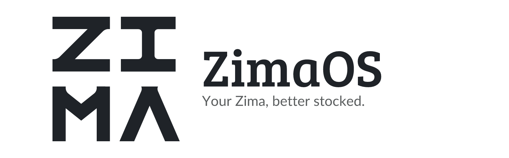
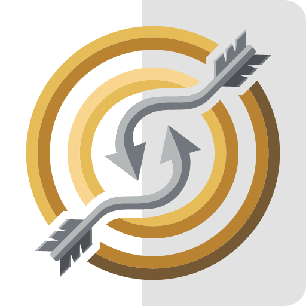
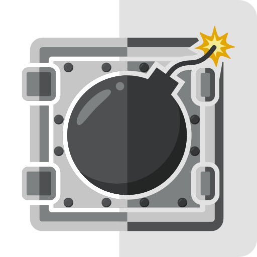
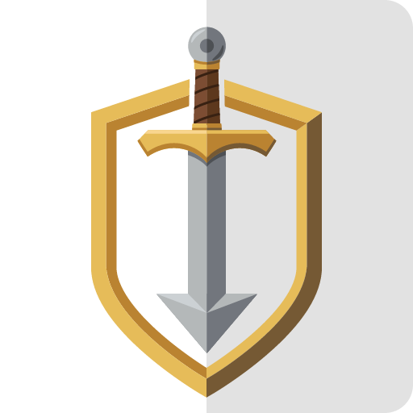
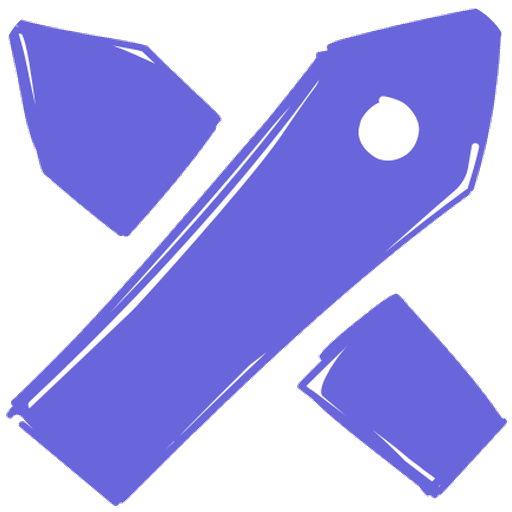
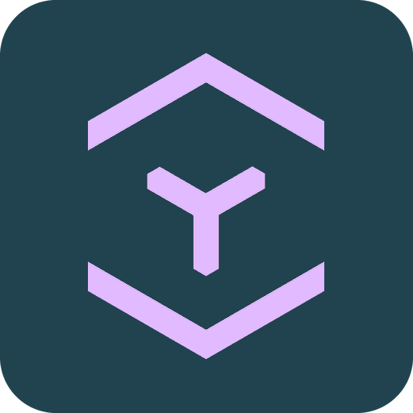
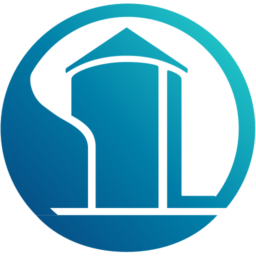

<p align="center">
  <picture>
    <source media="(prefers-color-scheme: dark)" srcset=".github/assets/banner-dark.png">
    
  </picture>
</p>

<p align="center">
  <a href="https://github.com/junkerderprovinz/zimaos-apps/actions/workflows/generate.yml"></a>&nbsp;
  <a href="#apps"></a>&nbsp;
  <a href="https://github.com/junkerderprovinz/zimaos-apps/commits/main"></a>&nbsp;
  <a href="https://github.com/IceWhaleTech/ZimaOS"></a>&nbsp;
  <a href="LICENSE"></a>
</p>

<p align="center">
A community app store for <a href="https://github.com/IceWhaleTech/ZimaOS">ZimaOS</a> and <a href="https://github.com/IceWhaleTech/CasaOS">CasaOS</a> with junkerderprovinz's containers, grouped like the profile: <b>Apps</b> (my own software), <b>Images</b> (my own image builds of third-party apps) and <b>Wrappers</b> (thin templates over an upstream image). One store to add; each app's image and full source live in its own repository.
</p>


<!-- apps:start -->
## Apps

*My own software, built and published by junkerderprovinz. Full docs live in each app's own repository.*

<a id="arrowloop"></a>

<a href="https://github.com/junkerderprovinz/arrowloop#readme"></a>
<a href="https://github.com/junkerderprovinz/arrowloop/blob/main/compose.yaml"></a>

**ArrowLoop**<br>
Two-way file sync that shows you the plan before it touches a file, sends deletions to a trash and stops a run that would delete too much.

<br clear="all">

<a id="bombvault"></a>

<a href="https://github.com/junkerderprovinz/bombvault#readme"></a>
<a href="https://github.com/junkerderprovinz/bombvault/blob/main/deploy/docker-compose.generic.yml"></a>

**BombVault**<br>
Backup and full disaster recovery for containers, VMs and the flash, powered by restic, with one-click backup and cross-server restore.

<br clear="all">

<a id="featherdrop"></a>

<a href="https://github.com/junkerderprovinz/featherdrop#readme"></a>
<a href="https://github.com/junkerderprovinz/featherdrop/blob/main/compose.yaml"></a>

**featherdrop**<br>
Your own private WeTransfer: feather-light, login-free, end-to-end encrypted file sharing with self-expiring share links.

<br clear="all">

<a id="knightloader"></a>

<a href="https://github.com/junkerderprovinz/knightloader#readme"></a>
<a href="https://github.com/junkerderprovinz/knightloader/blob/main/compose.yaml"></a>

**KnightLoader**<br>
Self-hosted download manager for hosters, debrid, torrents, Usenet and video, with an Android app and a browser extension.

<br clear="all">

<a id="trickwork"></a>

<a href="https://github.com/junkerderprovinz/trickwork#readme"></a>
<a href="https://github.com/junkerderprovinz/trickwork/blob/main/compose.yaml"></a>

**TrickWork**<br>
Turns images into proportional-font-aware ASCII art - a rebuild of ASCII Gen 2, picking characters by real ink coverage, not brightness.

<br clear="all">


## Images

*My own custom image builds of third-party apps. Full docs in each app's own repository.*

<a id="euro-office"></a>

<a href="https://github.com/junkerderprovinz/euro-office#readme"></a>
<a href="https://github.com/junkerderprovinz/euro-office/blob/main/compose.yaml"></a>

**Euro Office**<br>
Sovereign, OnlyOffice-compatible document server for browser editing of Office and OpenDocument files, wired into OpenCloud over WOPI.

<br clear="all">

<a id="excalidraw"></a>

<a href="https://github.com/junkerderprovinz/excalidraw#readme"></a>
<a href="https://github.com/junkerderprovinz/excalidraw/blob/main/compose.yaml"></a>

**Excalidraw**<br>
The hand-drawn whiteboard, built so it keeps to itself: shared links, live collaboration, the session scene and even the fonts all come from your own server.

<br clear="all">

<a id="garage"></a>

<a href="https://github.com/junkerderprovinz/garage#readme"></a>
<a href="https://github.com/junkerderprovinz/garage/blob/main/compose.yaml"></a>

**Garage**<br>
Garage's S3-compatible object store and its web admin panel in one container, with the single-node layout and S3 keys created automatically.

<br clear="all">

<a id="handbrake"></a>

<a href="https://github.com/junkerderprovinz/handbrake#readme"></a>
<a href="https://github.com/junkerderprovinz/handbrake/blob/main/compose.yaml"></a>

**HandBrake**<br>
HandBrake's full GUI on a fast Selkies web desktop, GPU-accelerated on NVIDIA, Intel and AMD, with a watch folder that converts on its own.

<br clear="all">

<a id="jdownloader"></a>

<a href="https://github.com/junkerderprovinz/jdownloader#readme"></a>
<a href="https://github.com/junkerderprovinz/jdownloader/blob/main/compose.yaml"></a>

**JDownloader**<br>
JDownloader 2 with a complete, sleek dark UI out of the box, on a fast Selkies web desktop in your browser. No VNC client, no install.

<br clear="all">

<a id="krusader"></a>

<a href="https://github.com/junkerderprovinz/krusader#readme"></a>
<a href="https://github.com/junkerderprovinz/krusader/blob/main/compose.yaml"></a>

**Krusader**<br>
Twin-pane KDE file manager with a native dark theme on a fast Selkies web desktop, with Kate, krename and RAR built in.

<br clear="all">

<a id="opencloud"></a>

<a href="https://github.com/junkerderprovinz/opencloud#readme"></a>
<a href="https://github.com/junkerderprovinz/opencloud/blob/main/compose.yaml"></a>

**OpenCloud**<br>
One-click OpenCloud file sync &amp; share: auto-runs init, heals appdata permissions and honours PUID/PGID.

<br clear="all">

<a id="prusaslicer"></a>

<a href="https://github.com/junkerderprovinz/prusaslicer#readme"></a>
<a href="https://github.com/junkerderprovinz/prusaslicer/blob/main/compose.yaml"></a>

**PrusaSlicer**<br>
The PrusaSlicer 3D-printing slicer in your browser on a fast Selkies web desktop: slice and export G-code, no VNC client (amd64 + arm64).

<br clear="all">

<a id="seafile"></a>

<a href="https://github.com/junkerderprovinz/seafile#readme"></a>
<a href="https://github.com/junkerderprovinz/seafile/blob/main/compose.yaml"></a>

**Seafile**<br>
The official Seafile server from one template, with its secrets generated on first start and MariaDB, Redis and the notification server built in on request.

<br clear="all">

<a id="securo"></a>

<a href="https://github.com/junkerderprovinz/securo#readme"></a>
<a href="https://github.com/junkerderprovinz/securo/blob/main/compose.yaml"></a>

**Securo**<br>
The Securo finance manager with its worker and scheduler in one container, on your own PostgreSQL and Redis or on built-in ones.

<br clear="all">

<a id="stellarium"></a>

<a href="https://github.com/junkerderprovinz/stellarium#readme"></a>
<a href="https://github.com/junkerderprovinz/stellarium/blob/main/compose.yaml"></a>

**Stellarium**<br>
The Stellarium planetarium in your browser on a fast Selkies web desktop: pan the sky, zoom a nebula, scrub through time, no VNC client.

<br clear="all">


## Wrappers

*Thin templates over a third-party upstream image (no custom build). Full docs in each app's folder below.*

<a id="couchdb"></a>

<a href="https://github.com/junkerderprovinz/unraid-apps/blob/main/couchdb/README.md"></a>
<a href="https://github.com/junkerderprovinz/unraid-apps/blob/main/couchdb/compose.yaml"></a>

**CouchDB**<br>
The HTTP/JSON document database behind Obsidian LiveSync, on the official 3.x image with data, config and CORS mapped so they survive a recreate or update.

<br clear="all">

<a id="rustfs"></a>

<a href="https://github.com/junkerderprovinz/unraid-apps/blob/main/rustfs/README.md"></a>
<a href="https://github.com/junkerderprovinz/unraid-apps/blob/main/rustfs/compose.yaml"></a>

**RustFS**<br>
An S3 object store in Rust, with the two fixes it needs to run on Unraid at all. Pre-release: every version so far is a release candidate.

<br clear="all">

<a id="seaweedfs"></a>

<a href="https://github.com/junkerderprovinz/unraid-apps/blob/main/seaweedfs/README.md"></a>
<a href="https://github.com/junkerderprovinz/unraid-apps/blob/main/seaweedfs/compose.yaml"></a>

**SeaweedFS**<br>
Fast, S3-API-compatible object store on the official image, the actively-maintained alternative now that MinIO's open edition is done.

<br clear="all">

<a id="silo"></a>

<a href="https://github.com/junkerderprovinz/unraid-apps/blob/main/silo/README.md"></a>
<a href="https://github.com/junkerderprovinz/unraid-apps/blob/main/silo/compose.yaml"></a>

**Silo**<br>
MinIO, still maintained: PGSTY's fork of the open-source server, with the full web console. It reads an existing MinIO data folder as it is.

<br clear="all">

<a id="standardnotes-webui"></a>

<a href="https://github.com/junkerderprovinz/unraid-apps/blob/main/standardnotes-webui/README.md"></a>
<a href="https://github.com/junkerderprovinz/unraid-apps/blob/main/standardnotes-webui/compose.yaml"></a>

**Standard Notes Web UI**<br>
The official Standard Notes web client, self-hosted next to your own sync server for end-to-end encrypted notes in the browser.

<br clear="all">

<a id="versitygw"></a>

<a href="https://github.com/junkerderprovinz/unraid-apps/blob/main/versitygw/README.md"></a>
<a href="https://github.com/junkerderprovinz/unraid-apps/blob/main/versitygw/compose.yaml"></a>

**VersityGW**<br>
An S3 API in front of a share you already have: top-level folders become buckets, and every file stays readable over SMB and NFS at the same time.

<br clear="all">
<!-- apps:end -->


## Install

On ZimaOS: open the **App Store**, click the gear next to **Community store**, then **+**, and add

```
https://junkerderprovinz.github.io/zimaos-apps/store.json
```

The apps then show up under **Junker der Provinz** in the store's sidebar.

On CasaOS: open the **App Store**, click the number of apps at the top right of the list, choose **More apps** and add

```
https://github.com/junkerderprovinz/zimaos-apps/archive/refs/heads/main.zip
```

The apps then appear in the App Store next to the others.

Seafile and OpenCloud need the address they are reached at before their first start. Fill it in under **Custom Installation**; their page says which field under **Tips**. Apps that need a login or a key of their own (CouchDB, Euro-Office, OpenCloud, RustFS, Silo, VersityGW) start with `admin` and `casaos`, the login ZimaOS itself starts with. Change it under **Custom Installation** before you store real data.

Questions and bugs go to the issue tracker of the app's own repository; every app links it under **Get Support**.


## How these differ from the Unraid templates

The apps are built from the Unraid templates in [unraid-apps](https://github.com/junkerderprovinz/unraid-apps), through the same compose files the app repositories offer for other Docker hosts, with the changes ZimaOS needs:

- Appdata goes to `/DATA/AppData/<app>`. File managers and slicers see all of `/DATA`, downloads land in `/DATA/Downloads`.
- `PUID`, `PGID` and `TZ` come from ZimaOS.
- A password or key that the Unraid template asks for at install time starts as `casaos`, a user name or access key as `admin`, so a plain **Install** gets the app running.
- RustFS runs as root, because ZimaOS creates its data folder as root and the image's own user cannot write to it.
- Apps without a web page of their own (JuiceFS, ParleyPort) and apps that need a database next to them (Matrix, n8n, Claper) are not in the store yet.

To change an app, edit its template in unraid-apps, not the files in `Apps/`, `.github/readme-icons/` or the app list in this README. A workflow here rebuilds them every night and publishes the store. To build them by hand:

```sh
python3 tools/generate.py ../unraid-apps
```

`apps.json` lists the apps in the store with their store category. Per app it can also set where a folder goes on ZimaOS (`paths`), name the upstream developer (`developer`), replace the short text and description (`tagline`, `description`) where the Unraid ones talk about Unraid, set variables (`env`, for example Silo's start password, which MinIO wants eight characters long), read a template file with another name (`xml`), leave a path out (`drop_paths`), add a line to the install tip (`tip`) or pick another internal name (`name`). CasaOS keys its catalog by that name across all stores, so Excalidraw and HandBrake use `excalidraw-jdp` and `handbrake-jdp` to sit next to the official ones instead of hiding them.


## How AI is used here

One knight builds this, and AI is one of the tools I work with, the same way I work with an editor or a compiler. It helps me write code and documentation and it checks my work, and that saves me a good many evenings. It does not make the decisions, though. I read and understand everything before it ships, and if something here breaks, that is on me and not on the tool.

You do not have to take my word for it. The code is open and every release note is written by hand. The issue tracker shows how problems actually get handled, including the ones I got wrong the first time. If you find something that is not right, open an issue and I will look at it.

## Support

A one-knight job: I build them, keep them running, work through the issues and add what people ask for, until nothing is missing. They are free, with no accounts, no telemetry, no ads and no paid tier. No asterisk anywhere. Nothing readable ever leaves your own walls. Forged on evenings and weekends, with heart and stubbornness.

If one of these has earned a place on your server or computer, toss a coin to your knight: it helps cover the costs and keeps the project alive. It also makes this knight's heart beat a little faster. Three ways below, whichever suits you.

<p align="center">
  <a href="https://buymeacoffee.com/junkerderprovinz"></a>
  &nbsp;
  <a href="https://www.paypal.com/donate/?hosted_button_id=76FVV52TKXTUS"></a>
  &nbsp;
  <a href="https://junkerderprovinz.github.io/junkerderprovinz/"></a>
</p>
